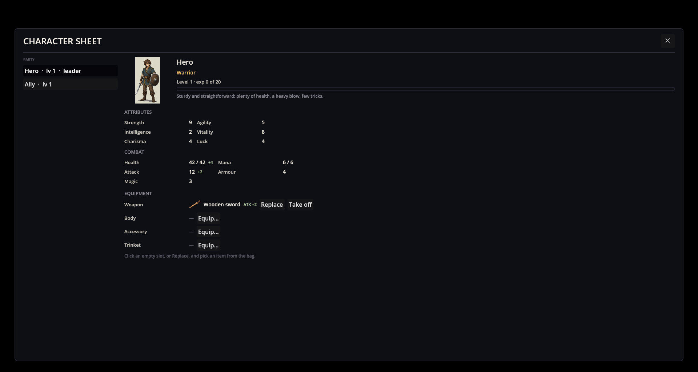

# Stats Engine — numbers that describe a character

Stats Engine lets a game count things about its characters: strength and health in an RPG, courage or trust in a visual novel. A game describes its stats as data — what they are called, how they are computed from each other, how they grow with level — and the engine computes every character's sheet, shows it in the **Character sheet** panel, lets scenarios check and change the numbers, and hands health, attack and defence to the battles.

The engine itself knows no stats at all. The strength, agility, health and mana in the pictures below come from **Classic RPG Rules**, a rules pack that RPG Plus includes; another game can bring entirely different stats with the same engine.

## The character sheet

Open it with the sheet icon on the toolbar.


- **Party** on the left, once there are two heroes or more: click a name to show that hero's sheet. The shown hero is highlighted, and the leader, the player's hero, is marked as leader.
- **Class, level and experience** at the top, with the class description.
- **Stats in groups**, named by the game. A small green number is the part that comes from bonuses — gear, the class's traits. Stats that are spent and refilled, like mana, show current / maximum.
- **Blocks of other mods** below, such as Equipment with its Equip, Replace and Take off buttons.



## One choice, two different heroes

In the RPG Plus prologue the player says who the hero was. The answer gives the hero a class — an **archetype** — and the whole sheet follows from it:


The scenario line behind the answer:

```scenario
action stat.archetype who=rpg_hero id=classic/warrior
```

The warrior archetype in Classic RPG Rules:

```json
{
  "Id": "classic/warrior",
  "Name": "classic/archetype/warrior",
  "Stats": { "str": "7 + level * 2", "agi": "4 + level", "int": "2 + floor(level / 2)",
             "vit": "6 + level * 2", "cha": "4 + floor(level / 2)", "luk": "4 + floor(level / 2)" },
  "Traits": [ { "Stat": "hp", "Percent": 10 } ],
  "Learnings": [ { "Level": 1, "Action": "classic/power_strike" }, { "Level": 3, "Action": "classic/guard_break" } ]
}
```

and two of its stats:

```json
{
  "Kind": "stat",
  "Items": [
    { "Id": "hp",  "Group": "combat", "Formula": "12 + vit * 3 + level * 2", "Min": 1, "Binds": "health" },
    { "Id": "atk", "Group": "combat", "Formula": "str + level", "Min": 0, "Binds": "attack" }
  ]
}
```

At level 1 the warrior has Strength 7 + 2 = **9** and Vitality 6 + 2 = **8**. Health is 12 + 8 × 3 + 2 = 38, and the warrior's trait adds 10% — **42**, the "+4" on the sheet. Attack is 9 + 1 = 10, plus 2 from the wooden sword's trait — **12**. The mage's numbers come from the same stats and the mage archetype.

## For authors: describing stats

**Stats** are entities of kind `stat`:

- `Id`, and `Name`, `Short`, `Description` as translation keys;
- `Group` and `Order` — where it appears on the sheet (`stats/group/<group>` names the group);
- `Default`, or a `Formula` of other stats and `level`; `Min`, `Max`;
- `Pool: true` — a stat that is spent and refilled, like mana;
- `Binds` — the battle number it becomes: `health`, `attack`, `defence` or `point`;
- `Hidden` — counted but not shown.

**Archetypes** (kind `archetype`) are classes, or temperaments in a novel: `Stats` with a value or formula per stat, `Traits`, `Learnings` (actions learned at a level), `ExpCurve` and `MaxLevel`.

**Traits** — `{ "Stat": "atk", "Add": 2 }`, with `Add`, `Percent` or `Formula` — can be written into any entity: an archetype, a character, an item. That is how the wooden sword adds attack without the items mod knowing about stats.

**Formulas** use `+ - * / % ^`, comparisons, `&& || !`, `cond ? a : b` and functions such as `min`, `max`, `floor`, `round`, `clamp`, `rand(lo, hi)` and `chance(p)`. Unknown names count as 0, and a broken formula is reported once in the log.

How a value is found: the character's own `Stats` entry, else the archetype's, else the stat's `Formula`, else `Default`; then permanent bonuses; then all traits; then `Min`/`Max`.

## In scenarios

```scenario
action stat.add stat=cha value=1 who=rpg_hero
action stat.exp value=35 who=rpg_hero
when "stat(rpg_hero, cha) >= 8" -> :charming
```

- `stat.add`, `stat.archetype`, `stat.exp` (experience, which raises the level by the curve), `stat.restore` (refill health and pools); `who=` is a character id, `player` or `party`.
- Conditions: `stat(who, stat)`, `level(who)`, `archetype(who, 'id')`. Ids with a slash are quoted.
- Stat checks with dice (`check cha 10 -> :label`) come from Stat Checks; gear from Equipment.

## Battles

Stats with `Binds` are written into the battle numbers of party members, so both battle systems use them without knowing about stats. Characters that have no archetype, stats or traits keep the numbers from their character file; a rules pack added to a game that does not use stats changes nothing in it.

## If something goes wrong

1. **A stat shows 0.** Its formula names a stat that does not exist (unknown names count as 0); the log reports a broken formula once.
2. **A character does not level up.** Only characters with an archetype level up, unless the game's setting `stats.leveling` is `all`.
3. **Battle numbers did not change.** The stat needs `Binds`, and the character must take part in stats (an archetype, own stats or traits, or worn gear).

## Shared expressions

Numeric expressions are supplied by `expressions_base`. See the [Expression Engine guide](../../expressions_base/docs/en.md) for syntax, strict assignments and mod-defined strategies.
