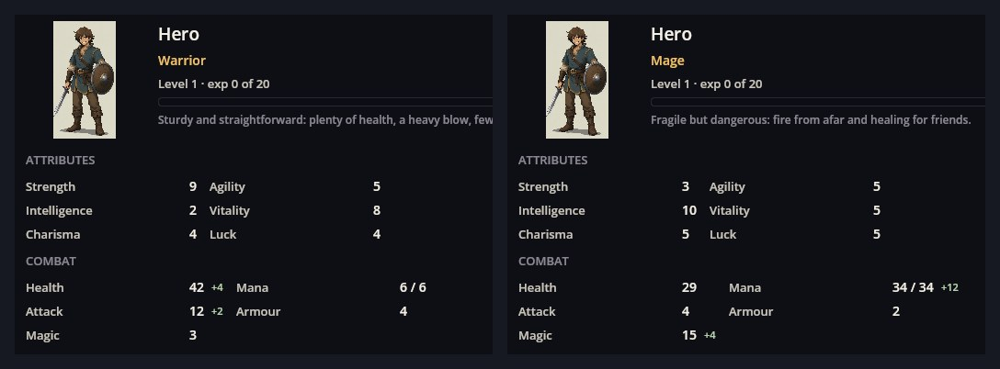

# Stats Engine — los números que describen a un personaje

Stats Engine permite a un juego contar cosas de sus personajes: fuerza y salud en un RPG, coraje o confianza en una novela visual. El juego describe sus estadísticas como datos —cómo se llaman, cómo se calculan unas a partir de otras, cómo crecen con el nivel— y el motor calcula la hoja de cada personaje, la muestra en el panel **Hoja de personaje**, deja que los escenarios consulten y cambien los números, y entrega la salud, el ataque y la defensa a los combates.

El motor en sí no conoce ninguna estadística. La fuerza, la agilidad, la salud y el maná de las imágenes de abajo vienen de **Classic RPG Rules**, un paquete de reglas que RPG Plus incluye; con el mismo motor, otro juego puede traer estadísticas completamente distintas.

## La hoja de personaje

Se abre con el icono de la hoja en la barra de herramientas.


- **Grupo** a la izquierda, cuando hay dos héroes o más: pulsa un nombre para ver la hoja de ese héroe. El héroe mostrado queda resaltado, y el líder, el héroe del jugador, va marcado como «líder».
- **Clase, nivel y experiencia** arriba, con la descripción de la clase.
- **Estadísticas agrupadas**, con los nombres que dé el juego. Un numerito verde es la parte que viene de bonificaciones: el equipo, los rasgos de la clase. Las estadísticas que se gastan y se rellenan, como el maná, muestran actual / máximo.
- **Bloques de otros mods** abajo, como Equipo, con sus botones Equipar, Reemplazar y Quitar.


## Una elección, dos héroes distintos

En el prólogo de RPG Plus el jugador cuenta quién era el héroe. La respuesta le da una clase —un **arquetipo**— y toda la hoja se deduce de ella:



La línea de escenario que hay detrás de la respuesta:

```scenario
action stat.archetype who=rpg_hero id=classic/warrior
```

El arquetipo de guerrero en Classic RPG Rules:

```json
{
  "Id": "classic/warrior",
  "Name": "classic/archetype/warrior",
  "Stats": { "str": "7 + level * 2", "agi": "4 + level", "int": "2 + floor(level / 2)",
             "vit": "6 + level * 2", "cha": "4 + floor(level / 2)", "luk": "4 + floor(level / 2)" },
  "Traits": [ { "Stat": "hp", "Percent": 10 } ],
  "Learnings": [ { "Level": 1, "Action": "classic/power_strike" }, { "Level": 3, "Action": "classic/guard_break" } ]
}
```

y dos de sus estadísticas:

```json
{ "Id": "hp",  "Group": "combat", "Formula": "12 + vit * 3 + level * 2", "Min": 1, "Binds": "health" },
{ "Id": "atk", "Group": "combat", "Formula": "str + level", "Min": 0, "Binds": "attack" }
```

En el nivel 1, el guerrero tiene Fuerza 7 + 2 = **9** y Vitalidad 6 + 2 = **8**. La salud es 12 + 8 × 3 + 2 = 38, y el rasgo del guerrero añade un 10%: **42**, el «+4» de la hoja. El ataque es 9 + 1 = 10, más 2 del rasgo de la espada de madera: **12**. Los números del mago salen de las mismas estadísticas y del arquetipo de mago.

## Para autores: describir estadísticas

**Las estadísticas** son entidades de tipo `stat`:

- `Id`, además de `Name`, `Short` y `Description` como claves de traducción;
- `Group` y `Order` — dónde aparece en la hoja (`stats/group/<group>` nombra el grupo);
- `Default`, o una `Formula` con otras estadísticas y `level`; `Min`, `Max`;
- `Pool: true` — una estadística que se gasta y se rellena, como el maná;
- `Binds` — el número de combate en el que se convierte: `health`, `attack`, `defence` o `point`;
- `Hidden` — se cuenta, pero no se muestra.

**Los arquetipos** (tipo `archetype`) son clases, o temperamentos en una novela: `Stats` con un valor o una fórmula por estadística, `Traits`, `Learnings` (acciones que se aprenden a cierto nivel), `ExpCurve` y `MaxLevel`.

**Los rasgos** — `{ "Stat": "atk", "Add": 2 }`, con `Add`, `Percent` o `Formula` — se pueden escribir en cualquier entidad: un arquetipo, un personaje, un objeto. Así añade ataque la espada de madera sin que el mod de objetos sepa nada de estadísticas.

**Las fórmulas** usan `+ - * / % ^`, comparaciones, `&& || !`, `cond ? a : b` y funciones como `min`, `max`, `floor`, `round`, `clamp`, `rand(lo, hi)` y `chance(p)`. Los nombres desconocidos valen 0, y una fórmula rota se informa una sola vez en el registro.

Cómo se obtiene un valor: la entrada `Stats` propia del personaje; si no, la del arquetipo; si no, la `Formula` de la estadística; si no, `Default`; después las bonificaciones permanentes; después todos los rasgos; al final `Min`/`Max`.

## En los escenarios

```scenario
action stat.add stat=cha value=1 who=rpg_hero
action stat.exp value=35 who=rpg_hero
when "stat(rpg_hero, cha) >= 8" -> :charming
```

- `stat.add`, `stat.archetype`, `stat.exp` (experiencia, que sube el nivel según la curva), `stat.restore` (rellena salud y reservas); `who=` es un id de personaje, `player` o `party`.
- Condiciones: `stat(who, stat)`, `level(who)`, `archetype(who, 'id')`. Los ids con barra se escriben entre comillas.
- Las pruebas de estadística con dados (`check cha 10 -> :label`) vienen de Stat Checks; el equipo, de Equipment.

## Combates

Las estadísticas con `Binds` se escriben en los números de combate de los miembros del grupo, así que los dos sistemas de combate las usan sin saber nada de estadísticas. Los personajes sin arquetipo, estadísticas ni rasgos conservan los números de su ficha; un paquete de reglas añadido a un juego que no usa estadísticas no cambia nada en él.

## Si algo falla

1. **Una estadística muestra 0.** Su fórmula nombra una estadística que no existe (los nombres desconocidos valen 0); el registro informa de la fórmula rota una sola vez.
2. **Un personaje no sube de nivel.** Solo suben de nivel los personajes con arquetipo, salvo que el ajuste `stats.leveling` del juego sea `all`.
3. **Los números de combate no cambiaron.** La estadística necesita `Binds`, y el personaje debe participar en las estadísticas (un arquetipo, estadísticas o rasgos propios, o equipo puesto).
