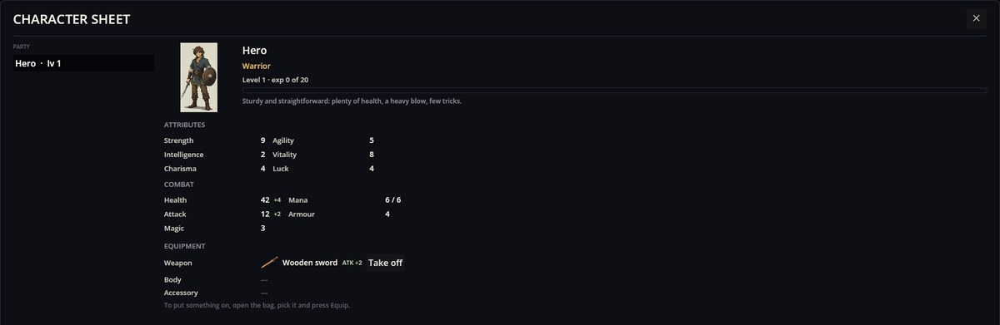

# Stats Engine — キャラクターを形づくる数字

Stats Engine は、ゲームがキャラクターについて何でも数えられるようにします。RPG なら筋力と HP、ビジュアルノベルなら勇気や信頼です。ゲームはステータスをデータとして記述します——名前、ほかのステータスからの計算方法、レベルに応じた伸び——そしてエンジンは各キャラクターのシートを計算し、**キャラクターシート**パネルに表示し、シナリオが数値を読み取って変更できるようにし、HP・攻撃・防御をバトルへ渡します。

エンジン自体はステータスをひとつも知りません。下の画像にある筋力・敏捷・HP・マナは、RPG Plus が含むルールパック **Classic RPG Rules** によるものです。同じエンジンで、まったく別のステータスを持つゲームも作れます。

## キャラクターシート

ツールバーのシートのアイコンで開きます。



- 左側は **パーティー**（2 人以上いるときに表示）。名前を押すと、その人のシートが表示されます。表示中の人は強調され、リーダー（プレイヤーの主人公）には「リーダー」と付きます。
- 上部は **職業・レベル・経験値** と、職業の説明。
- **ステータスはグループごと**に並び、名前はゲームが決めます。小さな緑の数字はボーナスのぶん——装備や職業の特性によるものです。マナのように消費して回復するステータスは「現在 / 最大」を表示します。
- 下の **他のモードのブロック**。例：装備の「装備する」「入れ替え」「外す」ボタン。


## ひとつの選択で、ふたりの違う主人公

RPG Plus のプロローグで、プレイヤーは主人公が何者だったかを語ります。その答えが職業——**アーキタイプ**——を与え、シート全体がそこから決まります。


その答えの裏にあるシナリオの行:

```scenario
action stat.archetype who=rpg_hero id=classic/warrior
```

Classic RPG Rules におけるウォリアーのアーキタイプ:

```json
{
  "Id": "classic/warrior",
  "Name": "classic/archetype/warrior",
  "Stats": { "str": "7 + level * 2", "agi": "4 + level", "int": "2 + floor(level / 2)",
             "vit": "6 + level * 2", "cha": "4 + floor(level / 2)", "luk": "4 + floor(level / 2)" },
  "Traits": [ { "Stat": "hp", "Percent": 10 } ],
  "Learnings": [ { "Level": 1, "Action": "classic/power_strike" }, { "Level": 3, "Action": "classic/guard_break" } ]
}
```

そしてステータス 2 つ:

```json
{
  "Kind": "stat",
  "Items": [
    { "Id": "hp",  "Group": "combat", "Formula": "12 + vit * 3 + level * 2", "Min": 1, "Binds": "health" },
    { "Id": "atk", "Group": "combat", "Formula": "str + level", "Min": 0, "Binds": "attack" }
  ]
}
```

レベル 1 のウォリアーは、筋力 7 + 2 = **9**、体力 6 + 2 = **8**。HP は 12 + 8 × 3 + 2 = 38 で、ウォリアーの特性が 10% 加えて **42**。シートの「+4」の正体です。攻撃は 9 + 1 = 10 に、木剣の特性の 2 を足して **12**。メイジの数字は、同じステータスとメイジのアーキタイプから出ています。

## 作者向け: ステータスの記述

**ステータス**は kind が `stat` のエンティティです。

- `Id`、および翻訳キーとしての `Name`、`Short`、`Description`。
- `Group` と `Order` — シートのどこに現れるか（`stats/group/<group>` がグループ名）。
- `Default`、またはほかのステータスと `level` による `Formula`。`Min`、`Max`。
- `Pool: true` — マナのように消費して回復するステータス。
- `Binds` — 化ける戦闘数値。`health`、`attack`、`defence`、`point`。
- `Hidden` — 計算はされるが表示しない。

**アーキタイプ**（kind は `archetype`）は職業、ノベルなら気質です。ステータスごとの値か式を持つ `Stats`、`Traits`、`Learnings`（レベルで覚えるアクション）、`ExpCurve`、`MaxLevel` を持ちます。

**特性**——`{ "Stat": "atk", "Add": 2 }` のようなもので、`Add`、`Percent`、`Formula` のいずれか——は、アーキタイプ・キャラクター・アイテム、どのエンティティにも書けます。木剣がアイテム MOD にステータスを意識させずに攻撃を上げているのはこの仕組みです。

**式**では `+ - * / % ^`、比較、`&& || !`、`cond ? a : b` が使え、`min`、`max`、`floor`、`round`、`clamp`、`rand(lo, hi)`、`chance(p)` といった関数もあります。知らない名前は 0 として数えられ、壊れた式はログに 1 回だけ報告されます。

値の決まり方: まずキャラクター自身の `Stats` の項目、なければアーキタイプのもの、なければステータスの `Formula`、なければ `Default`。その後に恒久ボーナス、すべての特性が続き、最後に `Min`/`Max` が締めます。

## シナリオの中で

```scenario
action stat.add stat=cha value=1 who=rpg_hero
action stat.exp value=35 who=rpg_hero
when "stat(rpg_hero, cha) >= 8" -> :charming
```

- `stat.add`、`stat.archetype`、`stat.exp`（経験値。曲線に従ってレベルを上げる）、`stat.restore`（HP とプールを回復）。`who=` にはキャラクターの id、`player`、`party`。
- 条件は `stat(who, stat)`、`level(who)`、`archetype(who, 'id')`。スラッシュ入りの id は引用符で囲みます。
- ダイスつきのステータス判定（`check cha 10 -> :label`）は Stat Checks が、装備は Equipment が担います。

## バトル

`Binds` を持つステータスは、パーティーメンバーの戦闘数値に書き込まれます。そのため両方のバトルコアが、ステータスを知らずにそのまま使います。アーキタイプもステータスも特性も持たないキャラクターは、キャラクターファイルの数値のままです。ステータスを使わないゲームにルールパックを加えても、何も変わりません。

## うまくいかないとき

1. **ステータスが 0 になる。** その式が存在しないステータスを参照しています（知らない名前は 0）。壊れた式はログに 1 回だけ報告されます。
2. **キャラクターがレベルアップしない。** レベルが上がるのはアーキタイプを持つキャラクターだけです。ゲーム設定 `stats.leveling` が `all` であれば別です。
3. **戦闘数値が変わらない。** ステータスに `Binds` が必要で、かつキャラクターがステータスに参加している（アーキタイプ、固有のステータスか特性、装備のいずれか）必要があります。

## 共通の式

`expressions_base` が計算を提供します。`set money=rnd(3,5)` は両端を含む整数、`cset total "1+2+${money}"` は式の結果を保存します。`set name value` は文字列のままです。誤りがあれば後続のアクションの前に会話を停止します。構文と拡張は[式エンジンのガイド](../../expressions_base/docs/en.md)を参照してください。
