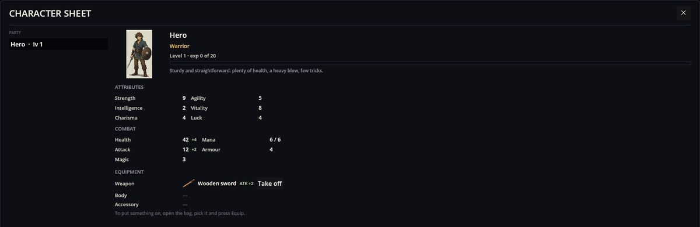

# Stats Engine — 캐릭터를 이루는 숫자

Stats Engine은 게임이 캐릭터에 대한 무엇이든 셀 수 있게 합니다. RPG라면 힘과 체력, 비주얼 노벨이라면 용기나 신뢰입니다. 게임은 능력치를 데이터로 기술합니다 — 이름, 서로를 계산하는 방식, 레벨에 따른 성장 — 그러면 엔진이 캐릭터마다 시트를 계산해 **캐릭터 시트** 패널에 보여 주고, 시나리오가 숫자를 읽고 바꾸게 하며, 체력·공격·방어를 전투로 넘깁니다.

엔진 자체는 능력치를 하나도 모릅니다. 아래 그림의 힘, 민첩, 체력, 마나는 RPG Plus에 들어 있는 규칙 팩 **Classic RPG Rules**에서 온 것입니다. 같은 엔진으로 완전히 다른 능력치를 지닌 게임도 만들 수 있습니다.

## 캐릭터 시트

툴바의 시트 아이콘으로 엽니다.



- 왼쪽 **파티**(둘 이상일 때 표시): 이름을 누르면 그 캐릭터의 시트가 나옵니다. 보고 있는 캐릭터는 강조되고, 리더(플레이어의 주인공)에는 '리더'라고 표시됩니다.
- 위에는 **직업·레벨·경험치**와 직업 설명.
- **능력치는 그룹별로** 나열되며 이름은 게임이 정합니다. 작은 초록 숫자는 보너스분 — 장비, 직업의 특성에서 옵니다. 마나처럼 쓰고 회복하는 능력치는 현재 / 최대로 표시됩니다.
- 아래의 **다른 모드의 블록**, 예: 장비의 '장착', '교체', '벗기' 버튼.


## 하나의 선택, 두 명의 다른 주인공

RPG Plus 프롤로그에서 플레이어는 주인공이 누구였는지 말합니다. 그 대답이 직업 — **원형** — 을 부여하고, 시트 전체가 거기서 따라 나옵니다:


그 대답 뒤의 시나리오 줄:

```scenario
action stat.archetype who=rpg_hero id=classic/warrior
```

Classic RPG Rules의 전사 원형:

```json
{
  "Id": "classic/warrior",
  "Name": "classic/archetype/warrior",
  "Stats": { "str": "7 + level * 2", "agi": "4 + level", "int": "2 + floor(level / 2)",
             "vit": "6 + level * 2", "cha": "4 + floor(level / 2)", "luk": "4 + floor(level / 2)" },
  "Traits": [ { "Stat": "hp", "Percent": 10 } ],
  "Learnings": [ { "Level": 1, "Action": "classic/power_strike" }, { "Level": 3, "Action": "classic/guard_break" } ]
}
```

그리고 그 능력치 둘:

```json
{
  "Kind": "stat",
  "Items": [
    { "Id": "hp",  "Group": "combat", "Formula": "12 + vit * 3 + level * 2", "Min": 1, "Binds": "health" },
    { "Id": "atk", "Group": "combat", "Formula": "str + level", "Min": 0, "Binds": "attack" }
  ]
}
```

레벨 1 전사는 힘 7 + 2 = **9**, 활력 6 + 2 = **8**입니다. 체력은 12 + 8 × 3 + 2 = 38이고 전사의 특성이 10%를 더해 **42**, 그러니까 시트의 "+4"가 됩니다. 공격은 9 + 1 = 10에 나무 검 특성의 2를 더해 **12**. 메이지의 숫자는 같은 능력치와 메이지 원형에서 나옵니다.

## 작성자용: 능력치 정의하기

**능력치**는 kind가 `stat`인 엔티티입니다.

- `Id`, 그리고 번역 키인 `Name`, `Short`, `Description`.
- `Group`과 `Order` — 시트의 어디에 나타나는지(`stats/group/<group>`가 그룹 이름).
- `Default`, 또는 다른 능력치와 `level`로 이루어진 `Formula`. `Min`, `Max`.
- `Pool: true` — 마나처럼 쓰고 회복하는 능력치.
- `Binds` — 바뀌어 들어갈 전투 수치. `health`, `attack`, `defence`, `point`.
- `Hidden` — 계산은 되지만 표시하지 않음.

**원형**(kind `archetype`)은 직업이고, 노벨에서는 기질입니다. 능력치마다 값이나 공식을 담는 `Stats`, `Traits`, `Learnings`(레벨에 따라 배우는 액션), `ExpCurve`, `MaxLevel`을 갖습니다.

**특성** — `{ "Stat": "atk", "Add": 2 }` 꼴이며 `Add`, `Percent`, `Formula`를 씁니다 — 는 원형, 캐릭터, 아이템 어느 엔티티에든 넣을 수 있습니다. 나무 검이 아이템 모드로 하여금 능력치를 모른 채 공격을 올리는 방법이 바로 이것입니다.

**공식**은 `+ - * / % ^`, 비교, `&& || !`, `cond ? a : b`를 쓰고, `min`, `max`, `floor`, `round`, `clamp`, `rand(lo, hi)`, `chance(p)` 같은 함수도 있습니다. 모르는 이름은 0으로 치고, 깨진 공식은 로그에 한 번만 보고됩니다.

값의 결정 순서: 캐릭터 자신의 `Stats` 항목, 없으면 원형의 것, 없으면 능력치의 `Formula`, 없으면 `Default`. 그다음 영구 보너스, 모든 특성이 이어지고 마지막에 `Min`/`Max`로 묶입니다.

## 시나리오에서

```scenario
action stat.add stat=cha value=1 who=rpg_hero
action stat.exp value=35 who=rpg_hero
when "stat(rpg_hero, cha) >= 8" -> :charming
```

- `stat.add`, `stat.archetype`, `stat.exp`(경험치. 곡선에 따라 레벨을 올림), `stat.restore`(체력과 소모형 능력치 회복). `who=`에는 캐릭터 id, `player`, `party`.
- 조건: `stat(who, stat)`, `level(who)`, `archetype(who, 'id')`. 슬래시가 들어간 id는 따옴표로 감쌉니다.
- 주사위가 들어가는 능력치 판정(`check cha 10 -> :label`)은 Stat Checks가, 장비는 Equipment가 맡습니다.

## 전투

`Binds`가 있는 능력치는 파티원의 전투 수치에 기록됩니다. 덕분에 두 전투 코어 모두 능력치를 모른 채 그대로 씁니다. 원형도 능력치도 특성도 없는 캐릭터는 캐릭터 파일의 수치를 유지하고, 능력치를 쓰지 않는 게임에 규칙 팩을 넣어도 아무것도 바뀌지 않습니다.

## 문제가 생겼을 때

1. **능력치가 0으로 보인다.** 그 공식이 존재하지 않는 능력치를 부르고 있습니다(모르는 이름은 0). 깨진 공식은 로그에 한 번 보고됩니다.
2. **캐릭터가 레벨업하지 않는다.** 레벨은 원형이 있는 캐릭터만 오릅니다. 게임 설정 `stats.leveling`이 `all`이면 예외입니다.
3. **전투 수치가 바뀌지 않았다.** 능력치에 `Binds`가 필요하고, 캐릭터는 능력치에 참여해야 합니다(원형, 고유 능력치나 특성, 착용 장비).

## 공통 표현식

`expressions_base`가 계산을 제공합니다. `set money=rnd(3,5)`는 양 끝을 포함한 정수, `cset total "1+2+${money}"`는 식의 결과를 저장합니다. `set name value`는 문자열을 그대로 저장합니다. 오류가 나면 의존 액션 전에 대화를 멈춥니다. 문법과 확장은 [표현식 엔진 가이드](../../expressions_base/docs/en.md)를 참고하세요.
