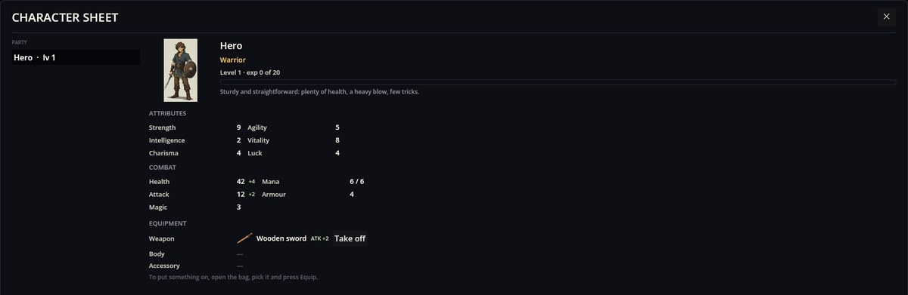

# Stats Engine — числа, из которых состоит персонаж

Stats Engine позволяет игре считать что угодно о своих персонажах: силу и здоровье в RPG, смелость или доверие в визуальной новелле. Игра описывает статы данными — как они называются, как считаются друг из друга, как растут с уровнем, — а движок вычисляет лист каждого персонажа, показывает его в панели **Лист персонажа**, даёт сценариям проверять и менять числа и передаёт здоровье, атаку и защиту боевым системам.

Сам движок не знает ни одного стата. Сила, ловкость, здоровье и мана на картинках ниже приходят из набора правил **Classic RPG Rules**, который входит в RPG Plus; с тем же движком другая игра может описать совершенно другие статы.

## Лист персонажа

Открывается иконкой листа на панели инструментов.



- **Отряд** слева: все члены отряда с их уровнями.
- **Класс, уровень и опыт** сверху, с описанием класса.
- **Статы по группам**, названным игрой. Маленькое зелёное число — часть, приходящаяся на бонусы: снаряжение, черты класса. Расходуемые статы вроде маны показывают «текущее / максимум».
- **Блоки других модов** ниже — например, «Снаряжение» с кнопками **Снять**.

## Один выбор — два разных героя

В прологе RPG Plus игрок рассказывает, кем был герой. Ответ даёт герою класс — **архетип**, — и весь лист следует из него:


Строка сценария за этим ответом:

```scenario
action stat.archetype who=rpg_hero id=classic/warrior
```

Архетип воина в Classic RPG Rules:

```json
{
  "Id": "classic/warrior",
  "Name": "classic/archetype/warrior",
  "Stats": { "str": "7 + level * 2", "agi": "4 + level", "int": "2 + floor(level / 2)",
             "vit": "6 + level * 2", "cha": "4 + floor(level / 2)", "luk": "4 + floor(level / 2)" },
  "Traits": [ { "Stat": "hp", "Percent": 10 } ],
  "Learnings": [ { "Level": 1, "Action": "classic/power_strike" }, { "Level": 3, "Action": "classic/guard_break" } ]
}
```

и два его стата:

```json
{ "Id": "hp",  "Group": "combat", "Formula": "12 + vit * 3 + level * 2", "Min": 1, "Binds": "health" },
{ "Id": "atk", "Group": "combat", "Formula": "str + level", "Min": 0, "Binds": "attack" }
```

На 1-м уровне у воина Сила 7 + 2 = **9** и Стойкость 6 + 2 = **8**. Здоровье — 12 + 8 × 3 + 2 = 38, а черта воина добавляет 10% — **42**, те самые «+4» на листе. Атака — 9 + 1 = 10, плюс 2 от черты деревянного меча — **12**. Числа мага получаются из тех же статов и архетипа мага.

## Авторам: описание статов

**Статы** — сущности вида `stat`:

- `Id`, а также `Name`, `Short` и `Description` — ключи перевода;
- `Group` и `Order` — где стат показывается на листе (`stats/group/<group>` задаёт имя группы);
- `Default` либо `Formula` из других статов и `level`; `Min`, `Max`;
- `Pool: true` — стат, который тратится и восполняется, как мана;
- `Binds` — боевое число, в которое он превращается: `health`, `attack`, `defence` или `point`;
- `Hidden` — считается, но не показывается.

**Архетипы** (вид `archetype`) — это классы, а в новелле — характеры: `Stats` со значением или формулой для каждого стата, `Traits`, `Learnings` (действия, осваиваемые с уровнем), `ExpCurve` и `MaxLevel`.

**Черты** — вида `{ "Stat": "atk", "Add": 2 }`, с `Add`, `Percent` или `Formula` — можно вписать в любую сущность: архетип, персонажа, предмет. Именно так деревянный меч добавляет атаку, и мод предметов не знает о статах.

**Формулы** используют `+ - * / % ^`, сравнения, `&& || !`, `cond ? a : b` и функции вроде `min`, `max`, `floor`, `round`, `clamp`, `rand(lo, hi)` и `chance(p)`. Незнакомые имена считаются нулём, а сломанная формула один раз попадает в журнал.

Как находится значение: собственная запись `Stats` персонажа, иначе запись архетипа, иначе `Formula` стата, иначе `Default`; затем постоянные прибавки; затем все черты; затем `Min`/`Max`.

## В сценариях

```scenario
action stat.add stat=cha value=1 who=rpg_hero
action stat.exp value=35 who=rpg_hero
when "stat(rpg_hero, cha) >= 8" -> :charming
```

- `stat.add`, `stat.archetype`, `stat.exp` (опыт, поднимающий уровень по кривой), `stat.restore` (восполняет здоровье и расходуемые статы); `who=` — id персонажа, `player` или `party`.
- Условия: `stat(who, stat)`, `level(who)`, `archetype(who, 'id')`. Идентификаторы со слэшем берутся в кавычки.
- Проверки статов с кубиками (`check cha 10 -> :label`) приносит Stat Checks; снаряжение — Equipment.

## Бои

Статы с `Binds` записываются в боевые числа участников отряда, поэтому обе боевые системы используют их, ничего не зная о статах. Персонажи без архетипа, статов и черт сохраняют числа из своего файла; набор правил, добавленный в игру без статов, в ней ничего не меняет.

## Если что-то пошло не так

1. **Стат показывает 0.** Его формула называет несуществующий стат (незнакомые имена считаются нулём); журнал сообщит о сломанной формуле один раз.
2. **Персонаж не повышает уровень.** Уровень растёт только у персонажей с архетипом — если настройка игры `stats.leveling` не равна `all`.
3. **Боевые числа не изменились.** Стату нужен `Binds`, а персонаж должен участвовать в статах: архетип, собственные статы или черты, надетое снаряжение.
