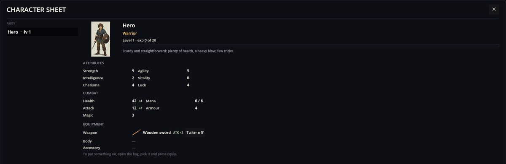

# Stats Engine — 描述角色的数字

Stats Engine 让游戏可以为角色记录各种数值：RPG 里的力量和生命，视觉小说里的勇气或信任。游戏用数据描述自己的属性——叫什么名字、如何由彼此推算、如何随等级成长——引擎则算出每个角色的面板，把它显示在**角色面板**中，让剧本能读取和修改这些数字，并把生命、攻击和防御交给战斗系统。

引擎本身不知道任何属性。下图中的力量、敏捷、生命和法力来自规则包 **Classic RPG Rules**，RPG Plus 包含了它；换了别的游戏，同一个引擎也能承载完全不同的属性。

## 角色面板

点工具栏上的面板图标即可打开。



- 左侧的**队伍**（有两名及以上角色时显示）：点击名字即可查看该角色的属性页。当前角色高亮，队长（玩家的主角）标有“队长”。
- 顶部是**职业、等级和经验**，附职业描述。
- **属性按组排列**，组名由游戏决定。绿色小数字是来自加成的部分——装备、职业的特性。会消耗也会恢复的属性（如法力）显示"当前 / 上限"。
- 下方是**其他模组的区块**，例如装备区的“装备”“替换”“卸下”按钮。


## 一个选择，两种不同的主角

在 RPG Plus 的序章里，玩家要说明主角过去是什么人。答案为主角赋予一个职业——一个**原型**——整个面板都由它推算而来：


这个答案背后的剧本行：

```scenario
action stat.archetype who=rpg_hero id=classic/warrior
```

Classic RPG Rules 中的战士原型：

```json
{
  "Id": "classic/warrior",
  "Name": "classic/archetype/warrior",
  "Stats": { "str": "7 + level * 2", "agi": "4 + level", "int": "2 + floor(level / 2)",
             "vit": "6 + level * 2", "cha": "4 + floor(level / 2)", "luk": "4 + floor(level / 2)" },
  "Traits": [ { "Stat": "hp", "Percent": 10 } ],
  "Learnings": [ { "Level": 1, "Action": "classic/power_strike" }, { "Level": 3, "Action": "classic/guard_break" } ]
}
```

以及它的两个属性：

```json
{ "Id": "hp",  "Group": "combat", "Formula": "12 + vit * 3 + level * 2", "Min": 1, "Binds": "health" },
{ "Id": "atk", "Group": "combat", "Formula": "str + level", "Min": 0, "Binds": "attack" }
```

1 级战士的力量是 7 + 2 = **9**，体质是 6 + 2 = **8**。生命为 12 + 8 × 3 + 2 = 38，战士的特性再加 10%——**42**，也就是面板上的"+4"。攻击为 9 + 1 = 10，加上木剑特性的 2——**12**。法师的数字来自同样的属性和法师原型。

## 给作者：描述属性

**属性**是 kind 为 `stat` 的实体：

- `Id`，以及作为翻译键的 `Name`、`Short`、`Description`；
- `Group` 和 `Order`——它在面板上的位置（`stats/group/<group>` 为组命名）；
- `Default`，或由其他属性和 `level` 组成的 `Formula`；`Min`、`Max`；
- `Pool: true`——会消耗也会恢复的属性，如法力；
- `Binds`——它写入的战斗数值：`health`、`attack`、`defence` 或 `point`；
- `Hidden`——参与计算但不显示。

**原型**（kind 为 `archetype`）就是职业，在小说里则是性格：`Stats` 为每个属性给出数值或公式，另有 `Traits`、`Learnings`（随等级学会的动作）、`ExpCurve` 和 `MaxLevel`。

**特性**——形如 `{ "Stat": "atk", "Add": 2 }`，用 `Add`、`Percent` 或 `Formula`——可以写进任何实体：原型、角色、物品。木剑就是这样加攻击的，物品模组对此毫不知情。

**公式**可用 `+ - * / % ^`、比较、`&& || !`、`cond ? a : b`，以及 `min`、`max`、`floor`、`round`、`clamp`、`rand(lo, hi)`、`chance(p)` 等函数。陌生的名字按 0 计，坏掉的公式会在日志里报告一次。

数值的取值顺序：角色自己的 `Stats` 条目，否则用原型的，否则用属性的 `Formula`，否则 `Default`；然后是永久加成；然后是所有特性；最后套 `Min`/`Max`。

## 在剧本中

```scenario
action stat.add stat=cha value=1 who=rpg_hero
action stat.exp value=35 who=rpg_hero
when "stat(rpg_hero, cha) >= 8" -> :charming
```

- `stat.add`、`stat.archetype`、`stat.exp`（经验，按曲线提升等级）、`stat.restore`（恢复生命和消耗型属性）；`who=` 是角色 id、`player` 或 `party`。
- 条件：`stat(who, stat)`、`level(who)`、`archetype(who, 'id')`。带斜杠的 id 要加引号。
- 带骰子的属性检定（`check cha 10 -> :label`）来自 Stat Checks；装备来自 Equipment。

## 战斗

带 `Binds` 的属性会写入队伍成员的战斗数值，因此两种战斗核心都能直接使用它们，完全不必知道属性的存在。没有原型、属性或特性的角色沿用角色文件里的数值；往不使用属性的游戏里加规则包，不会改变任何东西。

## 如果遇到问题

1. **某个属性显示 0。** 它的公式引用了不存在的属性（陌生名字按 0 计）；日志会就坏掉的公式报告一次。
2. **角色不升级。** 只有带原型的角色会升级，除非游戏设置 `stats.leveling` 为 `all`。
3. **战斗数值没有变化。** 属性需要 `Binds`，而且角色必须参与属性系统（有原型、自有属性或特性，或穿着装备）。
